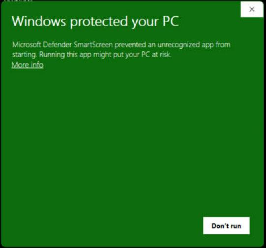

# Hearthsheet

A Windows desktop app for playing and managing a Dungeons & Dragons 5th Edition character.

One character model drives three views:

| View | Purpose |
|---|---|
| **Character Sheet** | The familiar three-page 5e sheet layout (main, backstory, spells). Every box is live and editable; zoom with Ctrl+wheel; prints to letter pages. |
| **Details** | The same character organized by category (Identity, Abilities & Saves, Skills, Combat, Proficiencies, Features, Equipment, Spells, Resources, Conditions & Effects, Biography) for comfortable editing. |
| **Play** | A session dashboard: damage/heal/temp HP, death saves, short and long rests, resources, spell slots, casting, conditions, effects, quick-add, and a session log. |

Characters are stored locally in SQLite, autosaved, backed up daily, and can be exported/imported as portable `.dndchar` files. The app checks GitHub Releases for updates and installs them after verifying the package checksum. Signing in to an optional cloud account (Account menu) keeps your characters in sync across computers; local storage stays the source of truth and everything keeps working offline.

## Requirements

- Windows 10/11 (x64)
- [.NET 10 SDK](https://dotnet.microsoft.com/download/dotnet/10.0) and [Inno Setup 6](https://jrsoftware.org/isinfo.php) (`winget install JRSoftware.InnoSetup`) to build from source. Nothing else is needed to run a release: .NET is bundled.

## Install (double-click to launch)

**From a release:** download **[Hearthsheet-Setup.exe](https://github.com/BDesro/Hearthsheet/releases/latest/download/Hearthsheet-Setup.exe)** (always the newest version) and double-click it.

Windows will warn you first, because Hearthsheet isn't signed by a registered publisher. Click **More info**, then **Run anyway**:



The installer asks only one thing, whether to add a desktop shortcut (ticked by default). It installs to `%LOCALAPPDATA%\Programs\Hearthsheet` without admin rights, adds a Start menu shortcut, and can launch the app when it's done.

After that, the app updates itself from new releases. Your characters live in `%LOCALAPPDATA%\Hearthsheet`, so reinstalling or updating never touches them. To remove it, use **Settings → Apps → Hearthsheet → Uninstall**. It asks whether to also delete your characters, settings and backups, and keeps them unless you say yes.

**From source:** this checks for the .NET 10 SDK (and points you to its download page if missing), builds the package, and runs the installer it produced:

```bash
powershell -ExecutionPolicy Bypass -File scripts/install.ps1
```

## Build, run, test

```bash
dotnet build Hearthsheet.slnx
```

```bash
dotnet run --project src/Hearthsheet.App
```

```bash
dotnet test Hearthsheet.slnx
```

Debug builds start in **development mode**: a diagnostics console window opens next to the app, and logging is verbose. See [Configuration](#configuration).

To keep test data away from your real characters:

```bash
dotnet run --project src/Hearthsheet.App -- --Application:DataDirectory=%TEMP%\hearthsheet-dev
```

## Packaging a release

```bash
pwsh ./scripts/publish.ps1
```

This produces `artifacts/Hearthsheet-Setup.exe` (the installer people download), `artifacts/Hearthsheet-<version>-win-x64.zip` (the in-app update package) and `artifacts/SHA256SUMS.txt`, with the .NET runtime bundled. It needs Inno Setup 6 (`winget install JRSoftware.InnoSetup`). Use it to check a package locally; published releases are built by GitHub Actions.

### Branches and releases

- **`main`** is what ships. Nothing is pushed to it directly: it only changes by merging a pull request from `dev`, and only when you decide to release.
- **`dev`** is the permanent integration branch. All work lands there through pull requests (feature branches off `dev`, PR into `dev`, CI must pass). Nothing is pushed to `dev` directly either.
- Merge feature PRs into `dev` with **squash**. Merge the `dev` → `main` release PR with a **merge commit**, so `dev` never diverges from `main`.

A release is the `dev` → `main` pull request. Put the version bump in it (on `dev`, via a normal PR first or as part of the last one): set `<Version>` in `Directory.Build.props` and rewrite `RELEASE_NOTES.md` for that version (plain text with `-` bullets, because the app's update dialog shows it as is). CI refuses a PR into `main` whose version is not newer than the latest release tag.

```bash
git checkout dev
git pull
gh pr create --base main --head dev --title "Release 1.3.0" --body "Changes: ..."
```

When CI passes, merge the PR (merge commit). The **Release** workflow then runs on `main` by itself: it reads `<Version>`, and if it is newer than the latest release it runs the tests, builds the installer, zip and checksums, and publishes the GitHub release, creating the tag on the merge commit. Otherwise it does nothing. Watch it with `gh run watch`, or in the repository's Actions tab. Installed copies show an "Update 1.3.0 available" button within a startup or two.

- Use [semantic versions](https://semver.org): patch for fixes, minor for features, major for breaking changes. Tags must be plain `X.Y.Z`; there is no pre-release channel.
- If a release is broken, don't move or delete the tag (the ruleset blocks it anyway). Fix forward with the next patch version, through `dev` as usual.

## Configuration

Settings are layered. Later sources override earlier ones, so no binary has to change:

1. `appsettings.json` next to the exe (shipped defaults)
2. `%LOCALAPPDATA%\Hearthsheet\appsettings.user.json` (per-user overrides; see `appsettings.user.example.json`)

| Key | Default | Meaning |
|---|---|---|
| `Application:DataDirectory` | `%LOCALAPPDATA%\Hearthsheet` | Where the database, logs, backups and update staging live. |
| `Logging:FileMinimumLevel` | `Information` | Minimum level written to the log file (set `Debug` for verbose logs). |
| `Updates:Owner` / `Updates:Repository` | *(empty)* | The GitHub repository whose releases are the update source. Update checks are off until these are set. |
| `Updates:CheckOnStartup` | `true` | Silent check at startup; a status-bar button appears when an update exists. |
| `Sync:Url` / `Sync:AnonKey` | *(the project's Supabase instance)* | The Supabase project URL and its public publishable key. When empty, the Account menu and sync are hidden. See [docs/CLOUD_SYNC.md](docs/CLOUD_SYNC.md) to use your own project. |

## Where things are stored

| What | Location |
|---|---|
| Characters | `%LOCALAPPDATA%\Hearthsheet\characters.db` (SQLite, WAL mode) |
| Daily backups (last 10) | `%LOCALAPPDATA%\Hearthsheet\backups\` |
| Logs | `%LOCALAPPDATA%\Hearthsheet\logs\app-YYYYMMDD.log`. In the app: Help → Open log folder |
| Updater log | `%LOCALAPPDATA%\Hearthsheet\logs\updater.log` |
| Cloud session (optional, only with "Stay signed in") | Windows Credential Manager → Windows Credentials → `Hearthsheet/supabase-session` |

## Keyboard shortcuts

Ctrl+N new character · Ctrl+S save · Ctrl+P print sheet · Ctrl+1/2/3 Sheet/Details/Play · Ctrl+Plus/Minus/0 zoom · Ctrl+mouse wheel zooms the sheet.

## More documentation

- [docs/ARCHITECTURE.md](docs/ARCHITECTURE.md): stack choice, layers, domain model, persistence, updates, security, testing, limitations and extension points
- [docs/CLOUD_SYNC.md](docs/CLOUD_SYNC.md): setting up the optional cloud sync (Supabase, Resend), the manual test script and troubleshooting
- [NOTICE.md](NOTICE.md): intellectual-property and licensing notes

## License

The code is under the [MIT License](LICENSE). The bundled SRD 5.1 game facts are separately licensed under CC-BY-4.0 (see [NOTICE.md](NOTICE.md)). *Dungeons & Dragons* is a trademark of Wizards of the Coast; this project is unofficial.
