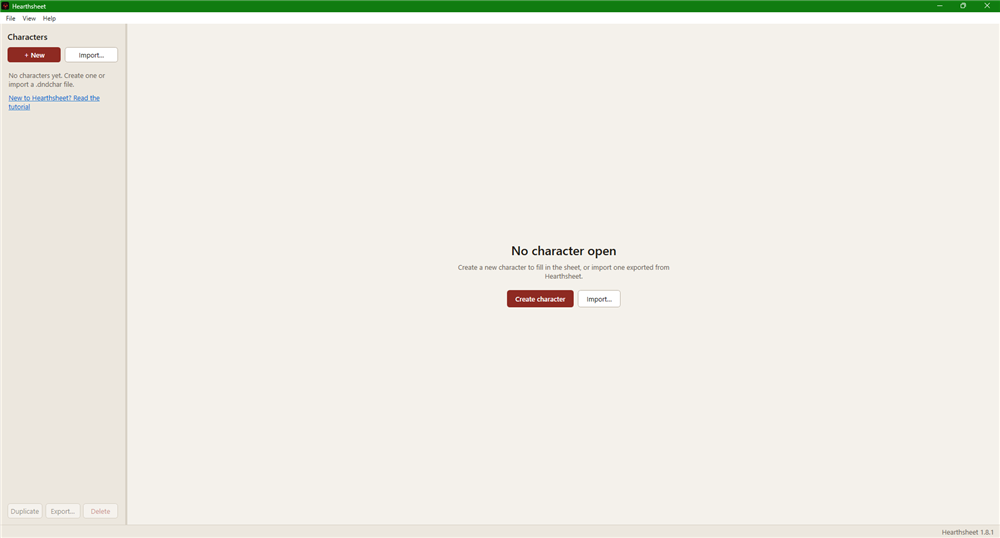
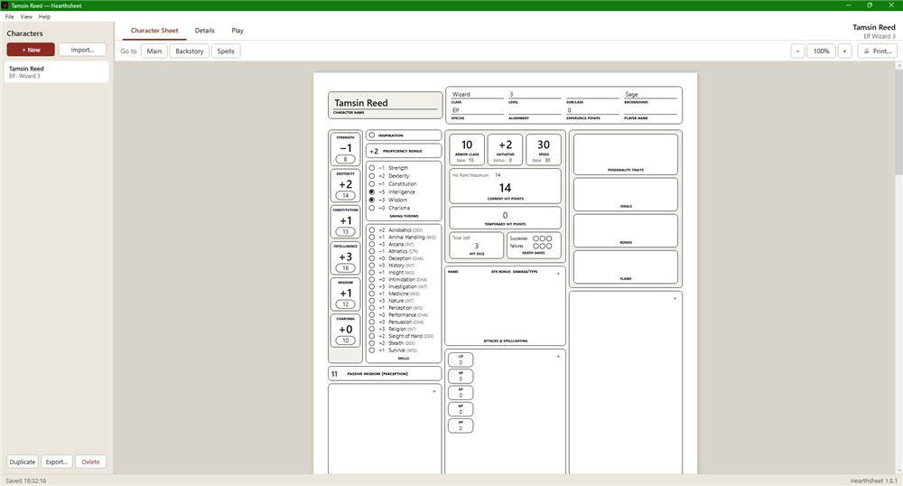
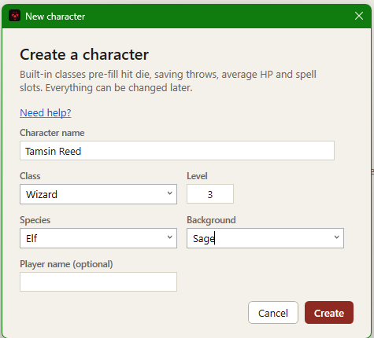
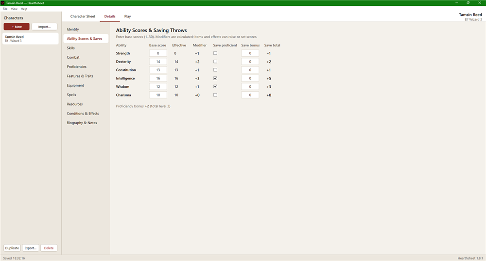
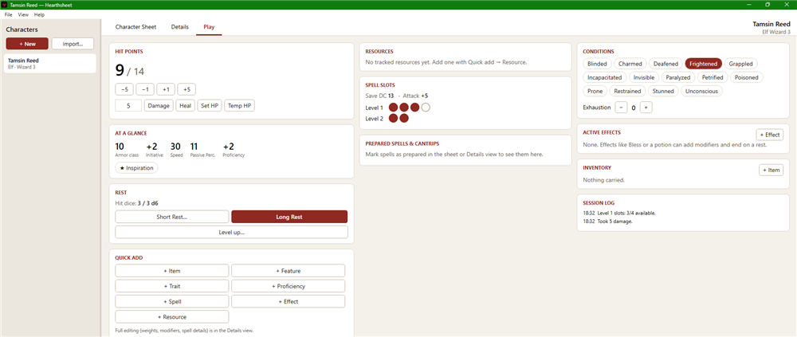
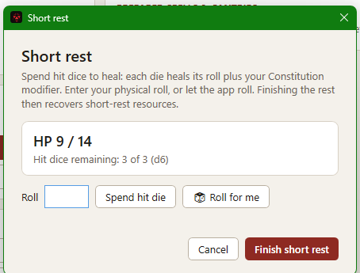
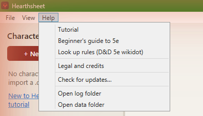

# Tutorial: your first character

Hearthsheet keeps one D&D 5e character in one place and shows it three ways. This walk-through takes you from an empty app to playing a session. If you're new to D&D itself, the [beginner's guide](beginners-guide.md) explains what the numbers mean.

## One character, three views

- **Character sheet** looks like the familiar three-page 5e sheet. Every box can be edited, and it prints to letter pages.
- **Details** shows the same character sorted into sections (Identity, Abilities & Saves, Skills, Combat, Features, Equipment, Spells and more). It's the comfortable place to fill things in.
- **Play** is your dashboard at the table: hit points, death saves, rests, spell slots, resources, conditions and a session log.

All three show the same character, so a change in one view appears in the others straight away. Switch views with the tabs at the top, from the **View** menu, or with Ctrl+1, Ctrl+2 and Ctrl+3.

## Creating a character

Choose **File → New character…** (Ctrl+N), or **Create character** when nothing is open.

- **Character name** is the only thing you must fill in.
- **Class** offers the built-in classes. Picking one fills in its hit die, saving throws, starting hit points and spell slots for you. You can also type a class that isn't listed and fill those in yourself.
- **Level**, **Species** and **Background** can all be changed later.

Click **Create**, and the new character opens in **Details**. Nothing here is final: every value can be edited afterwards.

## Filling in the character

Work down the sections in **Details**:

- **Ability Scores & Saves**: enter your six scores. Modifiers, saving throws and skill bonuses are worked out for you.
- **Skills**: mark the skills you're proficient in (or have expertise in).
- **Combat**: base armor class, speed and hit points.
- **Proficiencies, Features, Equipment and Spells**: add what your class, species and background give you. Hearthsheet doesn't include rules text, so type in your own notes, or look the wording up on the [D&D 5e wikidot](https://dnd5e.wikidot.com).

Totals such as armor class, attack bonuses and spell save DC update as you go. Equipped and attuned items, features and effects can add bonuses through their **modifiers**.

## Playing a session

Switch to **Play** when the game starts.

- **Hit points**: type an amount and press **Damage** or **Heal**. Temporary hit points are used up first. **Set HP** sets the number directly.
- **Death saves**: at 0 hit points, record each **Success** or **Failure**, or a **Natural 20** or **Natural 1**.
- **Spell slots and casting**: **Cast** a prepared spell and pick the slot level. Hearthsheet spends the slot and keeps track of concentration.
- **Resources**: class features with limited uses (rage, ki, channel divinity and so on) have a **Use** button.
- **Conditions and effects**: tick conditions as they happen, and add active effects that change your numbers for a while.
- **Quick add**: pick up an item, a spell or a feature mid-session without leaving Play.
- **Session log**: lists what you did this session.

## Rests and levelling up

- **Short Rest…** lets you spend hit dice, rolling them yourself or with **Roll for me**, then **Finish short rest**.

- **Long Rest** restores hit points, spell slots and the resources that come back on a long rest.
- **Level up…** walks you through the next level: pick the class (multiclassing is supported) and roll or take the average for hit points.

## Saving, backups and sharing

- Changes save by themselves a couple of seconds after you make them. **File → Save** (Ctrl+S) saves right away.
- Hearthsheet keeps a daily backup of your characters.
- **File → Export character…** writes a portable .dndchar file you can back up or share, and **Import character…** reads one back.
- **File → Print sheet…** (Ctrl+P) prints the three-page sheet.

## Using more than one device

If you want the same characters on another computer or in the web app, sign in from the **Account** menu. Your characters stay on this computer too, and everything keeps working offline.

## Getting help

The **Help** menu opens this tutorial, the beginner's guide and the legal notes at any time, and links to the D&D 5e wikidot for looking up rules.

## Keyboard shortcuts

- Ctrl+N: new character
- Ctrl+S: save
- Ctrl+P: print the sheet
- Ctrl+1, Ctrl+2, Ctrl+3: Character sheet, Details, Play
- Ctrl++ and Ctrl+−: zoom in and out (or Ctrl+mouse wheel). Ctrl+0 resets the zoom.
